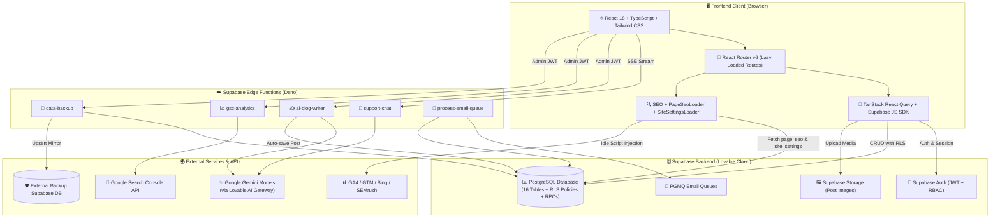

# 🌟 Md Shahed — Official Website & Digital Ecosystem (`shahed.com.bd`)

[](https://shahed.com.bd/)
[](https://shahedit.com/)
[](https://react.dev/)
[](https://www.typescriptlang.org/)
[](https://vitejs.dev/)
[](https://tailwindcss.com/)
[](https://supabase.com/)

> 👋 **স্বাগতম!** এটি **Md Shahed (মোহাম্মদ শাহেদ)**-এর অফিশিয়াল ওয়েবসাইট ([shahed.com.bd](https://shahed.com.bd))-এর সম্পূর্ণ সোর্স কোড ও টেকনিক্যাল ডকুমেন্টেশন। একজন ডেভেলপার যেন প্রজেক্টের **Frontend, Backend, Database, Edge Functions, AI Integrations, SEO Engine এবং Deployment Pipeline**-এর প্রতিটি অংশ খুব সহজে বুঝতে ও কাজ করতে পারেন, সেজন্য এই `README.md` ফাইলটি বিস্তারিতভাবে সাজানো হয়েছে।

---

## 📌 সূচিপত্র (Table of Contents)

1. [✨ প্রজেক্টের মূল বৈশিষ্ট্যসমূহ (Key Highlights)](#-প্রজেক্টের-মূল-বৈশিষ্ট্যসমূহ-key-highlights)
2. [🏗️ সিস্টেম আর্কিটেকচার (System Architecture)](#️-সিস্টেম-আর্কিটেকচার-system-architecture)
3. [💻 ব্যবহৃত প্রযুক্তি ও টুলস (Tech Stack)](#-ব্যবহৃত-প্রযুক্তি-ও-টুলস-tech-stack)
4. [🎨 ফ্রন্টএন্ড আর্কিটেকচার (Frontend Architecture)](#-ফ্রন্টএন্ড-আর্কিটেকচার-frontend-architecture)
5. [📄 সকল পেজ ও রাউটিং সিস্টেম (Pages & Routing Breakdown)](#-সকল-পেজ-ও-রাউটিং-সিস্টেম-pages--routing-breakdown)
6. [👑 অ্যাডমিন / সিইও কন্ট্রোল প্যানেল (`/ceo`)](#-অ্যাডমিন--সিইও-কন্ট্রোল-প্যানেল-ceo)
7. [🗄️ ব্যাকএন্ড ও ডাটাবেস স্কিমা (Backend & Database Architecture)](#️-ব্যাকএন্ড-ও-ডাটাবেস-স্কিমা-backend--database-architecture)
8. [☁️ সার্ভারলেস এজ ফাংশনসমূহ (Supabase Edge Functions)](#️-সার্ভারলেস-এজ-ফাংশনসমূহ-supabase-edge-functions)
9. [🚀 অ্যাডভান্সড এসইও ও পারফরম্যান্স ইঞ্জিনিয়ারিং (SEO & Performance)](#-অ্যাডভান্সড-এসইও-ও-পারফরম্যান্স-ইঞ্জিনিয়ারিং-seo--performance)
10. [📂 প্রজেক্টের ফোল্ডার স্ট্রাকচার (Directory Structure)](#-প্রজেক্টের-ফোল্ডার-স্ট্রাকচার-directory-structure)
11. [⚙️ লোকাল ডেভেলপমেন্ট ও ইনস্টলেশন (Local Development Setup)](#️-লোকাল-ডেভেলপমেন্ট-ও-ইনস্টলেশন-local-development-setup)
12. [🚢 ডিপ্লয়মেন্ট ও হোস্টিং গাইড (Deployment & CI/CD)](#-ডিপ্লয়মেন্ট-ও-হোস্টিং-গাইড-deployment--cicd)
13. [📬 যোগাযোগ (Contact & Identity)](#-যোগাযোগ-contact--identity)

---

## ✨ প্রজেক্টের মূল বৈশিষ্ট্যসমূহ (Key Highlights)

- 🌐 **হাই-পারফরম্যান্স SPA আর্কিটেকচার:** `Vite 5` + `React 18` + `TypeScript` দিয়ে তৈরি, যেখানে রুট-ভিত্তিক কোড স্প্লিটিং (`React.lazy`) ও ম্যানুয়াল বান্ডেল চাংকিং ব্যবহার করা হয়েছে।
- 🎨 **প্রিমিয়াম Glassmorphism ও ইন্টারেক্টিভ UI:** কাস্টমাইজড `shadcn/ui`, `Radix UI`, `Tailwind CSS`, জিরো-ল্যাগ ডেক্সটপ `CustomCursor`, `Magnetic` বাটন, `TiltCard`, এবং `GlowCard` অ্যানিমেশন।
- 🤖 **রিয়েল-টাইম AI কনসিয়ার্জ (`Shahed AI`):** ভিজিটরদের তাৎক্ষণিক সহায়তার জন্য `Google Gemini 3 Flash` চালিত স্ট্রিমিং চ্যাটবট এবং সরাসরি WhatsApp ইন্টিগ্রেশন।
- ✍️ **AI-Powered ব্লগ ইঞ্জিন:** অ্যাডমিন প্যানেল থেকে `Gemini 2.5 Flash` ব্যবহার করে ১-ক্লিকে সম্পূর্ণ SEO-অপ্টিমাইজড মার্কডাউন ব্লগ পোস্ট তৈরি ও পাবলিশ করার সুবিধা।
- 📱 **সোশ্যাল টাইমলাইন ও এনগেজমেন্ট:** ছবি আপলোডসহ লাইফস্টাইল/আপডেট পোস্ট, ভিজিটর ও ইউজারদের রিয়েল-টাইম লাইক (`post_likes`) এবং কমেন্ট (`post_comments`) সিস্টেম।
- 🔍 **গ্লোবাল কমান্ড প্যালেট (`Ctrl + K` / `/`):** কিবোর্ড শর্টকাটের মাধ্যমে পুরো ওয়েবসাইটের যেকোনো পেজ, সেকশন, প্রজেক্ট, সার্ভিস বা অ্যাডমিন টুলে তাৎক্ষণিক নেভিগেশন।
- 📈 **ফুল-স্ট্যাক SEO ও SEMrush স্যুট:** ডাইনামিক JSON-LD Knowledge Graph স্কিমা, অটোমেটিক `sitemap.xml` জেনারেটর, লাইভ Google Search Console অ্যানালিটিক্স, SEMrush পজিশন ট্র্যাকার এবং প্রতি পেজের মেটা ট্যাগ ওভাররাইড সিস্টেম।
- 🛡️ **এন্টারপ্রাইজ ডাটা ব্যাকআপ ও মিররিং:** অ্যাডমিন প্যানেল থেকে ১-ক্লিকে সম্পূর্ণ ডাটাবেস `JSON` বা `.sql` ফাইল হিসেবে ডাউনলোড এবং দ্বিতীয় কোনো Supabase প্রজেক্টে সরাসরি মিরর (Mirror) করার সুবিধা।

---

## 🏗️ সিস্টেম আর্কিটেকচার (System Architecture)

নিচের ডায়াগ্রামটি দেখায় কীভাবে ফ্রন্টএন্ড অ্যাপ্লিকেশন, সুপাবেস ব্যাকএন্ড, এজ ফাংশন এবং থার্ড-পার্টি সার্ভিসগুলো একে অপরের সাথে কাজ করে:



---

## 💻 ব্যবহৃত প্রযুক্তি ও টুলস (Tech Stack)

| ক্যাটাগরি | প্রযুক্তি / লাইব্রেরি | কী কাজে ব্যবহৃত হয়েছে |
| :--- | :--- | :--- |
| **⚛️ কোর ফ্রন্টএন্ড** | `React 18.3`, `TypeScript 5.8`, `Vite 5.4` (`@vitejs/plugin-react-swc`) | দ্রুতগতির কম্পোনেন্ট রেন্ডারিং, টাইপ-সেফটি এবং অপ্টিমাইজড প্রোডাকশন বিল্ড |
| **🎨 ইউআই ও স্টাইলিং** | `Tailwind CSS 3.4`, `shadcn/ui`, `@radix-ui/*`, `lucide-react` | রেসপনসিভ ডিজাইন, অ্যাক্সেসিবল মডাল/ড্রপডাউন/সাইডবার এবং আইকন সিস্টেম |
| **🧭 রাউটিং ও স্টেট** | `react-router-dom v6`, `@tanstack/react-query v5` | ক্লায়েন্ট-সাইড রাউটিং, ক্যাশিং এবং অ্যাসিনক্রোনাস সার্ভার স্টেট ম্যানেজমেন্ট |
| **📋 ফর্ম ও ভ্যালিডেশন** | `react-hook-form`, `zod`, `@hookform/resolvers` | লগইন, সাইন-আপ, কন্টাক্ট, ব্লগ ও কমেন্ট ফর্মের স্কিমা ভ্যালিডেশন |
| **📝 কনটেন্ট ও চার্ট** | `react-markdown`, `remark-gfm`, `recharts` | ব্লগ ও AI চ্যাটে মার্কডাউন রেন্ডারিং এবং অ্যাডমিন প্যানেলে GSC অ্যানালিটিক্স চার্ট |
| **🗄️ ব্যাকএন্ড ও ডাটাবেস** | `Supabase` (`@supabase/supabase-js v2`), `PostgreSQL 14+` | রিলেশনাল ডাটাবেস, Row Level Security (RLS), RPC ফাংশন এবং ইউজার অথেনটিকেশন |
| **☁️ সার্ভারলেস ফাংশন** | `Supabase Edge Functions` (`Deno` রানটাইম) | AI চ্যাট স্ট্রিমিং, AI ব্লগ রাইটার, GSC প্রক্সি, ডাটা ব্যাকআপ এবং ইমেইল কিউ প্রসেসিং |
| **🧪 টেস্টিং ও কোয়ালিটি** | `Vitest`, `@testing-library/react`, `Playwright`, `ESLint 9` | ইউনিট টেস্টিং, এন্ড-টু-এন্ড (E2E) ব্রাউজার টেস্টিং এবং কোড লিন্টিং |
| **🚀 ডিপ্লয়মেন্ট** | `Hostinger`, `GitHub Actions (FTPS)`, `Docker`, `Apache (.htaccess)` | অটোমেটেড CI/CD বিল্ড, কনটেইনারাইজেশন এবং SPA রুট হ্যান্ডলিং |

---

## 🎨 ফ্রন্টএন্ড আর্কিটেকচার (Frontend Architecture)

### ১. এন্ট্রি পয়েন্ট ও ইনস্ট্যান্ট স্প্ল্যাশ স্ক্রিন (`index.html` & `src/main.tsx`)
- **`index.html`:** ব্রাউজারে জাভাস্ক্রিপ্ট ডাউনলোড হওয়ার আগেই যেন ভিজিটর সাদা স্ক্রিন না দেখে, সেজন্য `index.html`-এর ভেতরে ইনলাইন CSS দিয়ে একটি হালকা লোডার এবং LCP অপ্টিমাইজেশনের জন্য `/hero-portrait.jpg` প্রিলোড (`fetchpriority="high"`) করা হয়েছে।
- **`src/main.tsx`:** React রুট মাউন্ট হওয়ার সাথে সাথে `requestAnimationFrame`-এর মাধ্যমে ইনলাইন লোডারটি স্মুথলি ফেড-আউট করে দেয়।

### ২. রুট কনফিগারেশন ও লেজি লোডিং (`src/App.tsx`)
- হোমপেজ (`Index.tsx`) সরাসরি ইমপোর্ট করা হয়েছে যেন প্রথম পেজটি তাৎক্ষণিক লোড হয়।
- বাকি সকল সেকেন্ডারি পেজ এবং `SupportWidget` কম্পোনেন্টটি `React.lazy()` এবং `<Suspense fallback={<RouteFallback />}>` দিয়ে মোড়ানো হয়েছে। এর ফলে প্রাথমিক জাভাস্ক্রিপ্ট বান্ডেল অত্যন্ত ছোট থাকে।
- গ্লোবাল প্রোভাইডার হিসেবে রয়েছে `QueryClientProvider`, `TooltipProvider`, `Toaster`, `Sonner`, এবং `BrowserRouter`।

### ৩. কাস্টম ইন্টারেক্টিভ ও ইউআই কম্পোনেন্টসমূহ (`src/components/`)
- 🖱️ **`CustomCursor.tsx`:** ডেক্সটপ ডিভাইসের জন্য `requestAnimationFrame` ও সরাসরি DOM ট্রান্সফর্ম (`translate3d`) ব্যবহার করে তৈরি জিরো-ল্যাগ কাস্টম মাউস কার্সর ও ফলোয়ার রিং।
- 🧲 **`ui/magnetic.tsx` (`Magnetic`):** মাউস কার্সর বাটনের কাছে নিলে বাটনটি হালকা চুম্বকের মতো কার্সরের দিকে আকৃষ্ট হয়।
- 🃏 **`ui/tilt-card.tsx` & `ui/glow-card.tsx`:** প্রজেক্ট ও সার্ভিস কার্ডগুলোর ওপর মাউস নাড়ালে 3D পার্সপেক্টিভ টিল্ট এবং রেডিয়াল গ্লো ইফেক্ট তৈরি করে।
- 🌊 **`ui/ripple-button.tsx`:** ক্লিক করলে মেটেরিয়াল-স্টাইল রিপল অ্যানিমেশনসহ কাস্টম বাটন।
- 🖼️ **`ui/smart-image.tsx`:** ইমেজ লোড হওয়ার সময় শিমার/ব্লার ইফেক্ট দেখায় এবং Cumulative Layout Shift (CLS) রোধ করে।
- 🔄 **`ui/page-transition.tsx`:** এক রুট থেকে অন্য রুটে যাওয়ার সময় স্মুথ ফেড ও ট্রানজিশন অ্যানিমেশন দেয়।
- 🧭 **`Navbar.tsx` & `Footer.tsx`:** রেসপনসিভ গ্লাসমরফিজম নেভিগেশন বার (সার্চ ট্রিগার, ইউজার মেনু ও মোবাইল ড্রয়ারসহ) এবং সব গুরুত্বপূর্ণ লিংকসহ ফুটার।

### ৪. গ্লোবাল উইজেটসমূহ (`SupportWidget.tsx` & `GlobalSearch.tsx`)
- 🤖 **`SupportWidget.tsx` (Shahed AI & WhatsApp):**
  - পাবলিক পেজগুলোতে নিচে ডানপাশে একটি অ্যানিমেটেড ফ্লোটিং বাটন দেখায় (`/ceo` অ্যাডমিন প্যানেলে এটি অটোমেটিক লুকানো থাকে)।
  - এতে দুটি মোড রয়েছে: **Chat with AI** (যেটি `support-chat` Edge Function থেকে Server-Sent Events স্ট্রিমিংয়ের মাধ্যমে উত্তর দেয়) এবং **WhatsApp Shahed** (সরাসরি `+880 1823 378888` নম্বরে চ্যাট ওপেন করে)।
- 🔍 **`GlobalSearch.tsx` (`useGlobalSearch` হুক):**
  - `cmdk` লাইব্রেরির ওপর ভিত্তি করে তৈরি কমান্ড প্যালেট। কিবোর্ডে `Ctrl + K` (বা Mac-এ `Cmd + K`) কিংবা `/` চাপলে ওপেন হয়।
  - `localStorage`-এ সর্বশেষ ৬টি সার্চ (`global_search_recent`) সেভ রাখে। কোনো ফলাফল না পেলে সরাসরি `site:shahed.com.bd` দিয়ে Google সার্চ করার অপশন দেয়।

### ৫. কাস্টম রিয়্যাক্ট হুকসমূহ (`src/hooks/`)
- 🔐 **`use-auth.tsx`:** Supabase Auth সেশন ট্র্যাক করে, ইউজারের `profiles` টেবিল থেকে তথ্য লোড করে এবং `signOut` ফাংশন দেয়।
- 🛡️ **`use-is-admin.tsx`:** ডাটাবেসের `user_roles` টেবিল চেক করে বর্তমান ইউজার `admin` কি না তা নির্ধারণ করে এবং অ্যানোনিমাস লাইকের জন্য ব্রাউজারে একটি ইউনিক `visitor_id` তৈরি ও সংরক্ষণ করে।
- 📱 **`use-mobile.tsx`:** স্ক্রিন ব্রেকপয়েন্ট অনুযায়ী মোবাইল ভিউ শনাক্ত করে।
- ✨ **`use-scroll-reveal.tsx`:** `IntersectionObserver` ব্যবহার করে স্ক্রল করার সাথে সাথে সেকশনগুলো অ্যানিমেটেডভাবে দৃশ্যমান করে।

---

## 📄 সকল পেজ ও রাউটিং সিস্টেম (Pages & Routing Breakdown)

প্রজেক্টের প্রতিটি রাউট এবং তার সংশ্লিষ্ট ফাইল নিচে দেওয়া হলো:

| রাউট (URL Path) | কম্পোনেন্ট ফাইল | কাজের বিবরণ |
| :--- | :--- | :--- |
| `/` | `src/pages/Index.tsx` + `LandingPage.tsx` | মূল ল্যান্ডিং পেজ (Hero, About, Skills, Projects, Services, Blog Preview, FAQ, Contact) |
| `/about` | `src/pages/About.tsx` | Md Shahed-এর বিস্তারিত জীবনী, শিক্ষা ও ক্যারিয়ার দর্শনের ডেডিকেটেড পেজ |
| `/skills` | `src/pages/Skills.tsx` | টেকনিক্যাল দক্ষতা, প্রোগ্রামিং ল্যাঙ্গুয়েজ, ফ্রেমওয়ার্ক ও বিজনেস স্কিল পেজ |
| `/projects` | `src/pages/Projects.tsx` | সম্পন্ন করা প্রজেক্ট ও কেস স্টাডি প্রদর্শনী |
| `/services` | `src/pages/Services.tsx` | ওয়েব ডেভেলপমেন্ট, ই-কমার্স, UI/UX এবং ব্র্যান্ডিং সার্ভিসের বিস্তারিত বিবরণ |
| `/contact` | `src/pages/Contact.tsx` | সরাসরি মেসেজ পাঠানোর ফর্ম (যা `support_tickets` টেবিলে জমা হয়) ও যোগাযোগের তথ্য |
| `/md-shahed` | `src/pages/MdShahed.tsx` | Google Knowledge Graph ও ব্র্যান্ড ভেরিফিকেশনের জন্য অফিশিয়াল প্রোফাইল পেজ |
| `/md-shahed-web-developer` | `src/pages/MdShahedWebDeveloper.tsx` | ওয়েব ডেভেলপার হিসেবে সার্ভিস ও পোর্টফোলিওর বিশেষ এসইও ল্যান্ডিং পেজ |
| `/bangladesh-web-development` | `src/pages/BangladeshWebDevelopment.tsx` | বাংলাদেশ মার্কেট ও লোকাল এসইও (GEO SEO) টার্গেটেড ল্যান্ডিং পেজ |
| `/shahed-business` | `src/pages/ShahedBusiness.tsx` | ব্যবসায়িক উদ্যোগ, Shahed IT এবং ডিজিটাল ভেঞ্চার সম্পর্কিত পেজ |
| `/digital-consulting` | `src/pages/DigitalConsulting.tsx` | ব্যবসার গ্রোথ স্ট্র্যাটেজি ও টেকনোলজি কনসাল্টিং পেজ |
| `/blog` | `src/pages/Blog.tsx` | প্রকাশিত সকল ব্লগ পোস্টের তালিকা, সার্চ ও ট্যাগ ফিল্টারিং |
| `/blog/:slug` | `src/pages/BlogPost.tsx` | একক ব্লগ পোস্ট রিডার (মার্কডাউন রেন্ডারিং, রিলেটেড পোস্ট ও Article Schema সহ) |
| `/blog/category/:tag` | `src/pages/BlogCategory.tsx` | নির্দিষ্ট ট্যাগ বা ক্যাটাগরির ব্লগ পোস্টগুলোর আর্কাইভ পেজ |
| `/timeline` | `src/pages/Timeline.tsx` | সোশ্যাল ফিড — অ্যাডমিন ছবি ও স্ট্যাটাস পোস্ট করতে পারেন; ভিজিটররা লাইক ও কমেন্ট করতে পারেন |
| `/login` ও `/signup` | `src/pages/Auth.tsx` | ইমেইল/পাসওয়ার্ড লগইন, সাইন-আপ, ফরগট পাসওয়ার্ড এবং পাসওয়ার্ড রিসেট ফ্লো |
| `/dashboard` | `src/pages/Dashboard.tsx` | রেজিস্টার্ড ইউজারদের ড্যাশবোর্ড (প্রোফাইল এডিট, পাসওয়ার্ড পরিবর্তন, নিজের লাইক/কমেন্ট হিস্ট্রি) |
| `*` | `src/pages/NotFound.tsx` | কাস্টম 404 Not Found পেজ (`noindex` মেটা ট্যাগসহ) |

---

## 👑 অ্যাডমিন / সিইও কন্ট্রোল প্যানেল (`/ceo`)

`/ceo` রাউট এবং এর ভেতরের সব সাব-রাউট `src/pages/ceo/CeoLayout.tsx` দ্বারা সুরক্ষিত। ইউজার লগইন না থাকলে `/login`-এ পাঠায় এবং লগইন থাকা সত্ত্বেও `user_roles` টেবিলে `admin` রোল না থাকলে **🔒 Access Denied** স্ক্রিন দেখায়।

| অ্যাডমিন রাউট | ফাইল | ফিচার ও কাজের বিবরণ |
| :--- | :--- | :--- |
| `/ceo` | `src/pages/ceo/Dashboard.tsx` | **রিয়েল-টাইম ওভারভিউ:** মোট Users, Customers, Products, Orders, Blog Posts, Likes, Comments ও Open Tickets-এর কাউন্টার এবং সর্বশেষ ১২টি অ্যাক্টিভিটির লাইভ ফিড। |
| `/ceo/blog` | `src/pages/ceo/Blog.tsx` | **ব্লগ ও AI রাইটার:** ব্লগ তৈরি, এডিট, ডিলিট, ড্রাফট/পাবলিশ টগল এবং **AI Write** মডাল (টপিক, কীওয়ার্ড, টোন ও ভাষা দিয়ে AI দিয়ে ব্লগ লেখানো)। |
| `/ceo/semrush` | `src/pages/ceo/SemrushSuite.tsx` | **SEMrush SEO Suite:** সাইট হেলথ ওভারভিউ, ১-ক্লিকে SEMrush Audit ও Google Rich Results টেস্ট লঞ্চার, বট ভেরিফিকেশন টোকেন সেভার এবং কীওয়ার্ড পজিশন ট্র্যাকার টেবিল। |
| `/ceo/rankings` | `src/pages/ceo/Rankings.tsx` | **Search Rankings (GSC):** গত ৭, ২৮, ৯০ বা ১৮০ দিনের Google Search Console-এর Clicks, Impressions, CTR, Average Position চার্ট এবং Top Queries/Pages/Countries টেবিল। |
| `/ceo/seo` | `src/pages/ceo/SeoManager.tsx` | **গ্লোবাল SEO ম্যানেজার:** অটোমেটিক SEO স্কোর (%), GA4 ID, GTM ID, GSC Token, Bing Token, ব্র্যান্ড নেম, টার্গেট কীওয়ার্ড ও ডিফল্ট OG Image সেটআপ এবং **Live Verification** চেকার। |
| `/ceo/page-seo` | `src/pages/ceo/PageSeo.tsx` | **Page SEO Overrides:** সাইটের যেকোনো নির্দিষ্ট পাথের (`/`, `/about`, `/blog` ইত্যাদি) জন্য আলাদা Title, Meta Description, OG Image এবং Canonical URL সেট করার প্যানেল। |
| `/ceo/tickets` | `src/pages/ceo/Tickets.tsx` | **Support Tickets:** কন্টাক্ট ফর্ম বা সাপোর্ট থেকে আসা মেসেজগুলো দেখা, স্ট্যাটাস (`open`, `closed`) ও প্রায়োরিটি ম্যানেজ করা। |
| `/ceo/backup` | `src/pages/ceo/Backup.tsx` | **ডাটা ব্যাকআপ ও মিরর:** ১-ক্লিকে পুরো ডাটাবেস `.json` বা `.sql` ফাইলে ডাউনলোড করা এবং বাহ্যিক Supabase প্রজেক্টে সব টেবিল মিরর (কপি) করা। |
| `/ceo/settings` | `src/pages/ceo/Settings.tsx` | **জেনারেল সেটিংস:** সাইটের নাম, ডিফল্ট ডেসক্রিপশন, টুইটার হ্যান্ডেল এবং অথেনটিকেশন সেটিংস। |

---

## 🗄️ ব্যাকএন্ড ও ডাটাবেস স্কিমা (Backend & Database Architecture)

ব্যাকএন্ড হিসেবে **Supabase (PostgreSQL)** ব্যবহৃত হয়েছে। ফ্রন্টএন্ড ক্লায়েন্ট কনফিগার করা আছে `src/integrations/supabase/client.ts` ফাইলে এবং সম্পূর্ণ টাইপ ডেফিনিশন রয়েছে `src/integrations/supabase/types.ts` ফাইলে। সব মাইগ্রেশন ফাইল সংরক্ষিত আছে `supabase/migrations/` ফোল্ডারে।

### 📊 ডাটাবেস টেবিলসমূহ (১৬টি পাবলিক টেবিল)

#### ১. ইউজার ও অ্যাক্সেস কন্ট্রোল (Users & RBAC)
- 👤 **`profiles`:** রেজিস্টার্ড ইউজারদের প্রোফাইল তথ্য (`id`, `user_id`, `display_name`, `username`, `avatar_url`, `bio`, `phone`, `created_at`, `updated_at`)। নতুন ইউজার সাইন-আপ করলে ডাটাবেস ট্রিগারের মাধ্যমে স্বয়ংক্রিয়ভাবে প্রোফাইল তৈরি হয়।
- 🛡️ **`user_roles`:** ইউজারের রোল সংরক্ষণ করে (`id`, `user_id`, `role` যেখানে `app_role` enum হলো `'admin' | 'user'`)।

#### ২. ব্লগ ও সোশ্যাল এনগেজমেন্ট (Content & Social Feed)
- 📝 **`posts`:** ব্লগ এবং সোশ্যাল টাইমলাইনের সব পোস্ট (`id`, `author_id`, `content`, `slug`, `seo_title`, `seo_description`, `og_image`, `image_urls`, `tags`, `published`, `created_at`, `updated_at`)।
- 💬 **`post_comments`:** পোস্টের কমেন্টসমূহ (`id`, `post_id`, `user_id`, `content`, `created_at`)।
- ❤️ **`post_likes`:** পোস্টের লাইকসমূহ (`id`, `post_id`, `user_id`, `visitor_id`, `created_at`)। লগইন ছাড়াও যাতে ভিজিটররা লাইক দিতে পারেন, সেজন্য ব্রাউজারের `visitor_id` ব্যবহৃত হয়।

#### ৩. এসইও ও গ্লোবাল কনফিগারেশন (SEO & Settings)
- 🌐 **`page_seo`:** রাউট-ভিত্তিক মেটা ট্যাগ ওভাররাইড (`id`, `path`, `title`, `description`, `canonical`, `og_image`, `updated_at`)।
- ⚙️ **`site_settings`:** সিঙ্গেলটন (`singleton = true`) JSONB কনফিগারেশন টেবিল (`id`, `data`, `singleton`, `updated_by`, `updated_at`)। এতে GA4, GTM, GSC, Bing, SEMrush টোকেন ও ব্র্যান্ড সেটিংস থাকে।

#### ৪. সাপোর্ট ও ই-কমার্স মডিউল (Support & Commerce Catalog)
- 🎫 **`support_tickets`:** ভিজিটরদের পাঠানো কন্টাক্ট/সাপোর্ট টিকেট (`id`, `name`, `email`, `subject`, `message`, `status`, `priority`, `created_at`)।
- 🛍️ **`customers`, `products`, `orders`, `coupons`:** গ্রাহক, প্রোডাক্ট ক্যাটালগ, অর্ডার এবং ডিসকাউন্ট কুপন ম্যানেজমেন্টের জন্য প্রস্তুতকৃত রিলেশনাল টেবিলসমূহ।

#### ৫. ইমেইল ইনফ্রাস্ট্রাকচার (Transactional & Auth Email System)
- 📧 **`email_send_log`:** পাঠানো ইমেইলের স্ট্যাটাস (`sent`, `failed`, `dlq`, `rate_limited`) ও এরর লগ।
- ⏱️ **`email_send_state`:** ইমেইল কিউয়ের ব্যাচ সাইজ, ডিলে (`send_delay_ms`), TTL এবং রেট-লিমিট কুলডাউন (`retry_after_until`) কনফিগারেশন।
- 🔕 **`email_unsubscribe_tokens` & `suppressed_emails`:** ইমেইল আনসাবস্ক্রাইব টোকেন এবং বাউন্সড/সাপ্রেসড ইমেইল তালিকা।

### ⚡ ডাটাবেস ফাংশনসমূহ (PostgreSQL RPC Functions)
- `get_public_site_settings()`: সাইটের পাবলিক সেটিংস নিরাপদে রিটার্ন করে (কোনো প্রাইভেট সিক্রেট এক্সপোজ না করে)।
- `has_role(_user_id, _role)`: RLS পলিসিতে ইউজার অ্যাডমিন কি না তা দ্রুত চেক করার Security Definer ফাংশন।
- `slugify(input)`: পোস্টের টাইটেল থেকে স্বয়ংক্রিয়ভাবে URL-friendly স্লাগ তৈরি করে।
- `enqueue_email`, `read_email_batch`, `delete_email`, `move_to_dlq`: PGMQ ইমেইল কিউ পরিচালনার ফাংশন।

---

## ☁️ সার্ভারলেস এজ ফাংশনসমূহ (Supabase Edge Functions)

`supabase/functions/` ফোল্ডারে মোট **৫টি Deno Edge Function** রয়েছে:

### ১. 🤖 `support-chat` (`supabase/functions/support-chat/index.ts`)
- **কাজ:** পাবলিক ওয়েবসাইটের `SupportWidget`-এর মেসেজ রিসিভ করে এবং **Shahed AI** পার্সোনা নিয়ে উত্তর দেয়।
- **প্রযুক্তি:** Lovable AI Gateway (`google/gemini-3-flash-preview` মডেল) ব্যবহার করে এবং `text/event-stream` (SSE) রেসপন্স পাঠায় যাতে চ্যাটবটে অক্ষরগুলো রিয়েল-টাইমে টাইপ হওয়ার মতো দেখা যায়।
- **নিরাপত্তা:** পাবলিক ভিজিটরদের জন্য উন্মুক্ত (`verify_jwt = false`), তবে রেট-লিমিট (`429`) ও কোটা (`402`) এরর হ্যান্ডলিং যুক্ত।

### ২. ✍️ `ai-blog-writer` (`supabase/functions/ai-blog-writer/index.ts`)
- **কাজ:** অ্যাডমিন প্যানেল থেকে টপিক, কীওয়ার্ড, টোন ও ভাষা দিলে ৭০০–১১০০ শব্দের একটি পূর্ণাঙ্গ SEO-অপ্টিমাইজড মার্কডাউন ব্লগ পোস্ট তৈরি করে।
- **প্রযুক্তি:** `google/gemini-2.5-flash` মডেলের **Structured Tool Calling (`publish_post`)** ব্যবহার করে একসাথে `seo_title`, `seo_description` এবং `content` জেনারেট করে। `autoSave: true` থাকলে সরাসরি `posts` টেবিলে সেভ করে।
- **নিরাপত্তা:** ইউজারের JWT টোকেন ও `user_roles` টেবিলে `admin` রোল যাচাই ছাড়া কাজ করে না।

### ৩. 📈 `gsc-analytics` (`supabase/functions/gsc-analytics/index.ts`)
- **কাজ:** অ্যাডমিন প্যানেলের `/ceo/rankings` পেজের জন্য Google Search Console API থেকে `https://shahed.com.bd/`-এর সার্চ পারফরম্যান্স ডেটা নিয়ে আসে।
- **প্রযুক্তি:** `Promise.all` ব্যবহার করে একসাথে Totals, Top Queries, Top Pages, Devices, Countries এবং Daily Trend ফেচ করে রিটার্ন করে।
- **নিরাপত্তা:** শুধুমাত্র ভেরিফাইড `admin` ইউজার অ্যাক্সেস করতে পারেন।

### ৪. 💾 `data-backup` (`supabase/functions/data-backup/index.ts`)
- **কাজ:** পুরো ডাটাবেসের ১৬টি পাবলিক টেবিল এবং `auth.users` থেকে ইউজারদের মেটাডাটা (নিরাপত্তার স্বার্থে পাসওয়ার্ড হ্যাশ বাদে) প্যাজিনেটেডভাবে রিড করে।
- **অ্যাকশনসমূহ:**
  - `status`: ব্যাকআপ স্কিমা ও মিরর স্ট্যাটাস জানায়।
  - `export`: সম্পূর্ণ ডাটাবেস একটি JSON অবজেক্ট হিসেবে ডাউনলোড করায়।
  - `sql`: টেবিল স্কিমা (`CREATE TABLE`) এবং সব ডেটার `INSERT ... ON CONFLICT DO NOTHING` স্টেটমেন্টসহ একটি পোর্টেবল `.sql` ফাইল তৈরি করে।
  - `mirror`: `BACKUP_SUPABASE_URL` ও `BACKUP_SUPABASE_SERVICE_ROLE_KEY` সেট করা থাকলে প্রতি ৫০০ রো-এর ব্যাচে অন্য Supabase প্রজেক্টে সব ডেটা Upsert করে।

### ৫. 📧 `process-email-queue` (`supabase/functions/process-email-queue/index.ts`)
- **কাজ:** ব্যাকগ্রাউন্ডে `auth_emails` (অগ্রাধিকার ভিত্তিক) এবং `transactional_emails` কিউ থেকে মেসেজ নিয়ে `@lovable.dev/email-js`-এর মাধ্যমে ইমেইল পাঠায়।
- **ফিচার:** ডুপ্লিকেট সেন্ড প্রতিরোধ (Idempotency guard), TTL এক্সপায়ারি চেক, সর্বোচ্চ ৫ বার রিট্রাই (`MAX_RETRIES = 5`), রেট-লিমিট কুলডাউন এবং ব্যর্থ ইমেইলকে Dead Letter Queue (`_dlq`)-তে স্থানান্তর।

---

## 🚀 অ্যাডভান্সড এসইও ও পারফরম্যান্স ইঞ্জিনিয়ারিং (SEO & Performance)

এই ওয়েবসাইটটি **Google Search, Google Knowledge Graph, SEMrush Audit এবং AI Search Engines (ChatGPT, Perplexity, Google AI Overviews)**-এ শীর্ষ র‍্যাঙ্কিং পাওয়ার জন্য বিশেষভাবে ইঞ্জিনিয়ারিং করা হয়েছে:

### ১. ক্যানোনিকাল আইডেন্টিটি ও JSON-LD Knowledge Graph (`src/lib/identity.ts` & `index.html`)
- `index.html` এবং `src/lib/identity.ts`-এ `https://shahed.com.bd/#person`, `#organization`, `#website`, এবং `#profile` আইডি দিয়ে পরস্পর সংযুক্ত (Linked Data) **JSON-LD Schema** যুক্ত করা হয়েছে:
  - 👤 **`Person` & `ProfilePage` Schema:** `MD Shahed`, `Md Shahed`, `Mohammad Shahed`, `শাহেদ` সহ সকল নামের ভ্যারিয়েশন, পেশা, ঠিকানা এবং ভেরিফাইড সোশ্যাল প্রোফাইল (`sameAs`)।
  - 🏢 **`Organization` & `ProfessionalService` Schema:** `Shahed IT`-এর পরিচয় ও সার্ভিস ক্যাটালগ।
  - ❓ **`FAQPage` & `BreadcrumbList` Schema:** গুগল সার্চে Rich Snippets ও সাইটলিংক প্রদর্শনের জন্য।

### ২. ৩-স্তরের ডাইনামিক মেটা ও স্ক্রিপ্ট ম্যানেজমেন্ট
1. **`SEO.tsx`:** প্রতিটি পেজ রেন্ডার হওয়ার সময় তার নিজস্ব `title`, `description`, `keywords`, Open Graph (`og:*`), Twitter Card (`twitter:*`), `hreflang` (`en`, `bn`, `x-default`) এবং পেজ-স্পেসিফিক JSON-LD হেডে যুক্ত করে।
2. **`PageSeoLoader.tsx`:** প্রতিবার রুট পরিবর্তনের সাথে সাথে ডুপ্লিকেট ক্যানোনিকাল ট্যাগ মুছে ফেলে এবং বর্তমান রুটের জন্য প্রোডাকশন ডোমেইন (`https://shahed.com.bd/current-path`)-কে `canonical` ও `og:url` হিসেবে পিন করে। এরপর ডাটাবেসের `page_seo` টেবিলে অ্যাডমিনের দেওয়া কোনো কাস্টম ওভাররাইড থাকলে তা প্রয়োগ করে।
3. **`SiteSettingsLoader.tsx`:** পেজ লোড হওয়ার পর ব্রাউজারের মেইন থ্রেড যখন ফ্রি থাকে (`requestIdleCallback`), তখন ডাটাবেসের `get_public_site_settings()` কল করে Google Analytics 4 (`gtag.js`), Google Tag Manager (`gtm.js`) এবং Search Console / Bing / SEMrush ভেরিফিকেশন ট্যাগ ইনজেক্ট করে। ফলে পেজের স্পিড (LCP/TBT) একটুও কমে না।

### ৩. বিল্ড-টাইম অটোমেটিক সাইটম্যাপ জেনারেটর (`scripts/generate-sitemap.ts`)
- `npm run dev` (`predev`) এবং `npm run build` (`prebuild`) চালানোর সময় স্বয়ংক্রিয়ভাবে `scripts/generate-sitemap.ts` রান হয়।
- এটি ১৩টি স্ট্যাটিক রাউটের পাশাপাশি সরাসরি Supabase REST API থেকে সকল প্রকাশিত (`published = true`) ব্লগ পোস্টের `slug` ও `updated_at` ফেচ করে `public/sitemap.xml` তৈরি করে।
- যদি বিল্ডের সময় কোনো কারণে ডাটাবেস অফলাইন থাকে, তবে এটি আগের কমিট করা `sitemap.xml` থেকে ব্লগের URL-গুলো অক্ষুণ্ণ রাখে।

### ৪. সার্চ বট ও AI LLM ইনডেক্সিং (`public/robots.txt` & `public/llms.txt`)
- 🤖 **`public/robots.txt`:** Googlebot, Bingbot এবং সকল SEMrush ক্রলার (`SemrushBot`, `SemrushBot-SA`, `SemrushBot-BA`)-কে সম্পূর্ণ ক্রলিং অনুমতি দেওয়া হয়েছে এবং সাইটম্যাপের লিংক যুক্ত করা হয়েছে।
- 🧠 **`public/llms.txt`:** আধুনিক AI সার্চ ইঞ্জিন ও Large Language Models (LLMs) যেন Md Shahed-এর পরিচয়, সার্ভিস, পেজ ও যোগাযোগের তথ্য নির্ভুলভাবে পড়তে পারে, সেজন্য স্ট্যান্ডার্ড `llms.txt` প্রোটোকল ফাইল রাখা হয়েছে।

---

## 📂 প্রজেক্টের ফোল্ডার স্ট্রাকচার (Directory Structure)

```text
shahed-me/
├── .github/
│   └── workflows/
│       └── deploy-hostinger.yml       # 🚀 GitHub Actions থেকে Hostinger-এ অটো FTPS ডিপ্লয়মেন্ট
├── public/
│   ├── .htaccess                      # 🌐 Apache SPA রুট ফলব্যাক, HTTPS ফোর্স ও ক্যাশিং রুলস
│   ├── llms.txt                       # 🧠 AI / LLM ক্রলারদের জন্য অফিশিয়াল আইডেন্টিটি ডকুমেন্ট
│   ├── robots.txt                     # 🤖 সার্চ ইঞ্জিন ও SEMrush বট ক্রলিং নির্দেশনা
│   ├── site.webmanifest               # 📱 PWA ম্যানিফেস্ট ফাইল
│   └── sitemap.xml                    # 🗺️ অটো-জেনারেটেড XML সাইটম্যাপ (Static + Dynamic Blog URLs)
├── scripts/
│   └── generate-sitemap.ts            # ⚡ বিল্ড-টাইমে Supabase থেকে পোস্ট নিয়ে সাইটম্যাপ তৈরির স্ক্রিপ্ট
├── src/
│   ├── assets/                        # 🖼️ অপ্টিমাইজড পোর্ট্রেট, প্রজেক্ট ও ব্লগ ইমেজসমূহ
│   ├── components/
│   │   ├── admin/
│   │   │   └── SeoPanel.tsx           # 🔍 অ্যাডমিন এসইও হেল্পার প্যানেল
│   │   ├── ceo/                       # 👑 অ্যাডমিন প্যানেলের সাইডবার ও হেডার কম্পোনেন্ট
│   │   │   ├── CeoSidebar.tsx
│   │   │   ├── ComingSoon.tsx
│   │   │   └── PageHeader.tsx
│   │   ├── ui/                        # 🎨 shadcn/ui + কাস্টম অ্যানিমেটেড ইউআই কম্পোনেন্টসমূহ
│   │   │   ├── glow-card.tsx
│   │   │   ├── magnetic.tsx
│   │   │   ├── page-transition.tsx
│   │   │   ├── ripple-button.tsx
│   │   │   ├── smart-image.tsx
│   │   │   ├── tilt-card.tsx
│   │   │   └── ... (৪০+ স্ট্যান্ডার্ড UI কম্পোনেন্ট)
│   │   ├── CustomCursor.tsx           # 🖱️ ডেক্সটপ স্মুথ কাস্টম কার্সর
│   │   ├── Footer.tsx                 # 🦶 গ্লোবাল ফুটার
│   │   ├── GlobalSearch.tsx           # 🔎 Ctrl+K গ্লোবাল কমান্ড প্যালেট সার্চ
│   │   ├── LandingPage.tsx            # 🏠 হোমপেজের সকল সেকশন ও ইন্টারঅ্যাক্টিভ লজিক
│   │   ├── Navbar.tsx                 # 🧭 গ্লোবাল রেসপনসিভ নেভিগেশন বার
│   │   ├── PageSeoLoader.tsx          # 🔗 ডাইনামিক ক্যানোনিকাল ও page_seo ওভাররাইড লোডার
│   │   ├── SEO.tsx                    # 🏷️ প্রতি পেজের মেটা ট্যাগ ও JSON-LD ম্যানেজার
│   │   ├── SiteSettingsLoader.tsx     # 📊 GA4, GTM ও ভেরিফিকেশন ট্যাগ আইডল লোডার
│   │   └── SupportWidget.tsx          # 🤖 Shahed AI চ্যাটবট ও WhatsApp সাপোর্ট উইজেট
│   ├── hooks/                         # 🪝 কাস্টম রিয়্যাক্ট হুকসমূহ (Auth, Admin Role, Scroll Reveal)
│   ├── integrations/
│   │   ├── lovable/                   # ☁️ Lovable Cloud OAuth ও ইন্টিগ্রেশন হেল্পার
│   │   └── supabase/                  # 🗄️ Supabase Client, Preview Auth Storage ও DB Types
│   ├── lib/
│   │   ├── blog-tags.ts               # 🏷️ ব্লগ ট্যাগ পার্সিং ও ক্যাটাগরি ইউটিলিটি
│   │   ├── identity.ts                # 🆔 ব্র্যান্ড আইডেন্টিটি কনস্ট্যান্ট ও JSON-LD স্কিমা
│   │   └── utils.ts                   # 🛠️ Tailwind class-merge (`cn`) ইউটিলিটি
│   ├── pages/                         # 📄 সকল পাবলিক পেজ এবং `/ceo/*` অ্যাডমিন পেজসমূহ
│   │   ├── ceo/                       # 👑 ৯টি অ্যাডমিন কন্ট্রোল প্যানেল পেজ
│   │   └── ... (১৭টি পাবলিক ও ইউজার পেজ)
│   ├── test/                          # 🧪 Vitest ইউনিট টেস্ট সেটআপ ও টেস্ট ফাইল
│   ├── App.tsx                        # 🧭 মূল রাউটার, লেজি লোডিং ও প্রোভাইডার ট্রি
│   ├── index.css                      # 🎨 গ্লোবাল CSS ভেরিয়েবল, থিম কালার ও গ্লাসমরফিজম ক্লাস
│   └── main.tsx                       # ⚡ রিয়্যাক্ট অ্যাপ মাউন্ট ও স্প্ল্যাশ স্ক্রিন রিমুভার
├── supabase/
│   ├── functions/                     # ☁️ ৫টি Deno Serverless Edge Functions
│   │   ├── ai-blog-writer/
│   │   ├── data-backup/
│   │   ├── gsc-analytics/
│   │   ├── process-email-queue/
│   │   └── support-chat/
│   ├── migrations/                    # 📜 ১৮টি SQL ডাটাবেস মাইগ্রেশন ফাইল
│   └── config.toml                    # ⚙️ Supabase প্রজেক্ট ও ফাংশন কনফিগারেশন
├── db.js                              # 🔌 ডিপ্লয়মেন্টের সময় Supabase কানেকশন টেস্ট স্ক্রিপ্ট
├── Dockerfile                         # 🐳 Node 20 মাল্টি-স্টেজ প্রোডাকশন ডকারফাইল
├── HOSTINGER-DEPLOY.md                # 📘 Hostinger-এ ডিপ্লয় করার বাংলা নির্দেশিকা
├── index.html                         # 🌐 মূল HTML শেল, ইনলাইন স্প্ল্যাশ ও স্ট্রাকচার্ড ডেটা
├── package.json                       # 📦 ডিপেন্ডেন্সি ও স্ক্রিপ্টসমূহ
├── tailwind.config.ts                 # 🎨 Tailwind থিম, ফন্ট ও অ্যানিমেশন কনফিগারেশন
└── vite.config.ts                     # ⚡ Vite বিল্ড, চাংক স্প্লিটিং ও ক্যাশ-বাস্টিং কনফিগারেশন
```

---

## ⚙️ লোকাল ডেভেলপমেন্ট ও ইনস্টলেশন (Local Development Setup)

আপনার লোকাল মেশিনে প্রজেক্টটি রান করার জন্য নিচের ধাপগুলো অনুসরণ করুন:

### ১. পূর্বশর্ত (Prerequisites)
- 🟢 **Node.js:** ভার্সন `>= 20.0.0` (প্রজেক্টে `.nvmrc` ফাইলে `20` সেট করা আছে)
- 📦 **Package Manager:** `npm` অথবা `bun`

### ২. রিপোজিটরি ক্লোন ও ডিপেন্ডেন্সি ইনস্টল
```bash
# ১. রিপোজিটরি ক্লোন করুন
git clone https://github.com/shahed-io/shahed-me.git

# ২. প্রজেক্ট ফোল্ডারে প্রবেশ করুন
cd shahed-me

# ৩. সকল প্যাকেজ ইনস্টল করুন
npm install
```

### ৩. এনভায়রনমেন্ট ভেরিয়েবল সেটআপ (`.env`)
প্রজেক্টের রুটে থাকা `.env.example` ফাইলটি দেখে `.env` ফাইল তৈরি বা যাচাই করুন:
```env
VITE_SUPABASE_PROJECT_ID="rporlqbfzsodsajgoasb"
VITE_SUPABASE_PUBLISHABLE_KEY="your_supabase_anon_public_key"
VITE_SUPABASE_URL="https://rporlqbfzsodsajgoasb.supabase.co"
```

### ৪. ডেভেলপমেন্ট সার্ভার চালু করা
```bash
npm run dev
```
> 💡 ডেভেলপমেন্ট সার্ভার ডিফল্টভাবে `http://localhost:8080` পোর্টে চালু হবে এবং চালুর আগে স্বয়ংক্রিয়ভাবে `npm run sitemap` চালিয়ে `public/sitemap.xml` আপডেট করে নেবে।

### 📜 সকল NPM স্ক্রিপ্টসমূহ (`package.json`)

| কমান্ড | কাজ |
| :--- | :--- |
| `npm run dev` | লোকাল ডেভেলপমেন্ট সার্ভার (`port 8080`) চালু করে |
| `npm run build` | সাইটম্যাপ আপডেট করে প্রোডাকশন বান্ডেল `dist/` ফোল্ডারে তৈরি করে |
| `npm run build:dev` | ডেভেলপমেন্ট মোডে বিল্ড তৈরি করে |
| `npm run preview` | বিল্ড করা প্রোডাকশন ফাইলগুলো লোকালি প্রিভিউ করে |
| `npm start` | `0.0.0.0` হোস্টে এবং `PORT` (ডিফল্ট `3000`) পোর্টে প্রোডাকশন সার্ভার চালায় |
| `npm run sitemap` | `tsx scripts/generate-sitemap.ts` চালিয়ে `public/sitemap.xml` জেনারেট করে |
| `npm run lint` | পুরো প্রজেক্টে ESLint কোড কোয়ালিটি চেক চালায় |
| `npm run test` | `Vitest` দিয়ে সকল ইউনিট টেস্ট রান করে |
| `npm run test:watch` | ওয়াচ মোডে টেস্ট রান করে |

---

## 🚢 ডিপ্লয়মেন্ট ও হোস্টিং গাইড (Deployment & CI/CD)

এই প্রজেক্টটি **Hostinger**, **Docker**, কিংবা যেকোনো স্ট্যাটিক/Node হোস্টিংয়ে ডিপ্লয় করার জন্য সম্পূর্ণ প্রস্তুত (বিস্তারিত বাংলা গাইড রয়েছে [`HOSTINGER-DEPLOY.md`](./HOSTINGER-DEPLOY.md) ফাইলে):

### ১. ⚡ Hostinger "Deploy Web App" (সরাসরি GitHub থেকে)
- **Node Version:** `20` (`.nvmrc` থেকে স্বয়ংক্রিয়ভাবে নেয়)
- **Install Command:** `npm ci`
- **Build Command:** `npm run build`
- **Output Directory:** `dist`
- **Start Command (Node App মোডে চালালে):** `npm start`

### ২. 🔄 GitHub Actions অটো-ডিপ্লয়মেন্ট (`.github/workflows/deploy-hostinger.yml`)
`main` ব্রাঞ্চে কোড পুশ করলেই GitHub Actions স্বয়ংক্রিয়ভাবে Node 20 সেটআপ করে `npm run build` চালায় এবং `FTPS` প্রোটোকলের মাধ্যমে `dist/` ফোল্ডারের ফাইলগুলো Hostinger-এর `/public_html/` ডিরেক্টরিতে আপলোড করে দেয়।

### ৩. 🐳 Docker Container ডিপ্লয়মেন্ট (`Dockerfile`)
প্রজেক্টে মাল্টি-স্টেজ `Dockerfile` রয়েছে যা `node:20-alpine` ইমেজে সাইট বিল্ড করে এবং `serve -s dist -l 3000` দিয়ে SPA ফলব্যাকসহ সার্ভ করে:
```bash
docker build -t shahed-web .
docker run -p 3000:3000 shahed-web
```

### ৪. 🛡️ Apache `.htaccess` ও ক্যাশ অপ্টিমাইজেশন (`public/.htaccess`)
- **SPA Routing:** `/blog`, `/timeline`, `/ceo` ইত্যাদি ক্লায়েন্ট-সাইড রাউট সরাসরি রিফ্রেশ করলে যেন `404` না আসে, সেজন্য সব রিকোয়েস্ট `index.html`-এ রিডাইরেক্ট করে।
- **Force HTTPS & Security Headers:** সব ট্রাফিক `https://`-এ ফোর্স করে এবং `X-Content-Type-Options`, `X-Frame-Options` ও `Referrer-Policy` যুক্ত করে।
- **Smart Caching:** `index.html` কখনো ক্যাশ করে না (`no-cache, no-store`), কিন্তু Vite-এর হ্যাশড অ্যাসেটগুলো (`assets/[name]-[hash].js/css`) ১ বছরের জন্য (`immutable`) ব্রাউজার ক্যাশে রাখে।

---

## 📬 যোগাযোগ (Contact & Identity)

- 👤 **নাম:** **Md Shahed (MD Shahed / মোহাম্মদ শাহেদ)**
- 💼 **পদবী:** Web Developer & Entrepreneur · Founder & CEO of **Shahed IT**
- 🌍 **অফিশিয়াল ওয়েবসাইট:** [https://shahed.com.bd](https://shahed.com.bd)
- 🏢 **কোম্পানি ওয়েবসাইট:** [https://shahedit.com](https://shahedit.com)
- 📧 **ইমেইল:** [ceo@shahed.com.bd](mailto:ceo@shahed.com.bd)
- 💬 **হোয়াটসঅ্যাপ ও ফোন:** [+880 1823-378888](https://wa.me/8801823378888)
- 🐙 **GitHub:** [@shahed-io](https://github.com/shahed-io)
- 💼 **LinkedIn:** [in/shahed-io](https://linkedin.com/in/shahed-io)
- 📘 **Facebook:** [shahed.io](https://facebook.com/shahed.io)
- 📸 **Instagram:** [@shahed.io](https://instagram.com/shahed.io)

---

> 💡 **Create. Build. Improve.** — *Engineered with precision for [shahed.com.bd](https://shahed.com.bd).*
